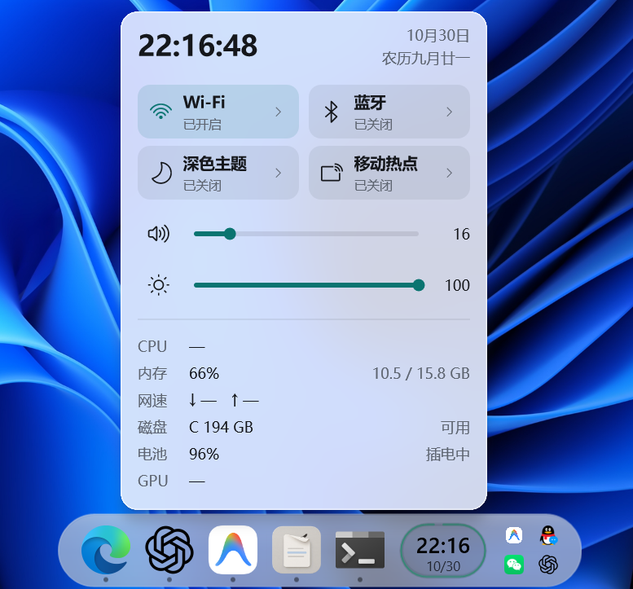
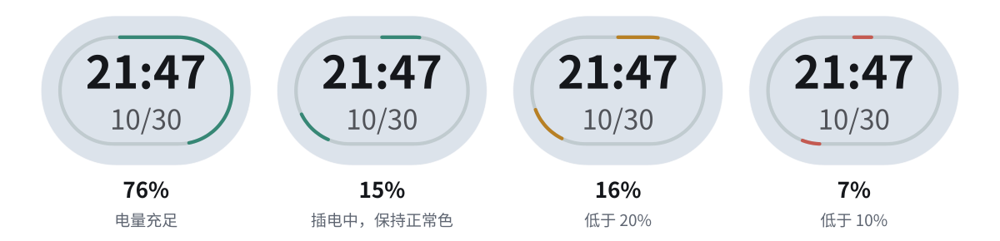
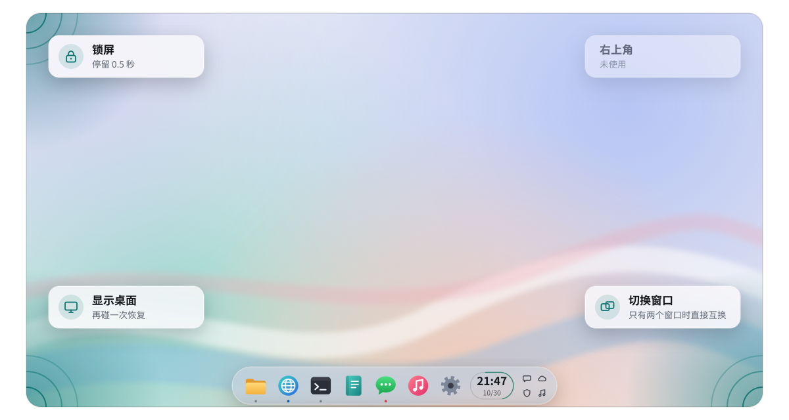

<div align="center">

# LeanDock

**把 Windows 11 的任务栏，安静地变成一条 Dock。**

不换掉任务栏，只让它更好看、更顺手。<br>
应用按钮、托盘、右键菜单，全都还是 Windows 原生的。


<br><br>



<sub>实机截图：鼠标停在时间键上，弹出详情面板</sub>

</div>

<br>

## ✨ 亮点

<table>
<tr>
<td width="50%" valign="top">

### 🪟 原生，不是仿制
Dock 就是 Windows 自己的任务栏换了身衣服。拖拽、跳转列表、托盘菜单、通知，一样不少，也一样稳。

</td>
<td width="50%" valign="top">

### 🕐 一颗键，装下整个状态栏
时间、日期、电量挤进一颗小小的腰圆键。悬停一下，CPU、显卡、网速、音量、亮度全都在。

</td>
</tr>
<tr>
<td width="50%" valign="top">

### 🖱️ 四个角都有用
左上锁屏，左下回桌面，右下切窗口。鼠标一甩就到，不用记快捷键。

</td>
<td width="50%" valign="top">

### 🪶 轻到感觉不到
只有一个隐藏的小进程。详情面板在鼠标停到时间键上时才启动，鼠标一走就退出，不在后台偷偷采样。

</td>
</tr>
</table>

## 🕐 聚合时间键

应用和托盘之间那颗腰圆键：大字是时间，小字是日期，外面一圈是电量。充电时日期右边有个小闪电。

| 操作 | 效果 |
|:--|:--|
| 单击 | 打开开始菜单 |
| 右键 | 打开 Win+X 菜单 |
| 悬停 0.4 秒 | 弹出详情面板 |

<picture>
  <source media="(prefers-color-scheme: dark)" srcset="docs/assets/keys-dark.svg">
  
</picture>

<sub>电量环从顶部顺时针走一圈。低于 20% 变黄，低于 10% 变红；插着电时始终是正常色。</sub>

**详情面板里有什么**

- **看**：带秒的时间 · 日期和星期 · 农历 · CPU 和最近 60 秒趋势 · 内存 · 每块显卡各自的 3D 占用 · 网速 · 磁盘剩余 · 电量和剩余时间 · 正在播放
- **调**：音量 · 亮度 · Wi-Fi · 蓝牙 · 深浅主题（连壁纸一起换）· 移动热点
- **二级页**：Wi-Fi、蓝牙、移动热点磁贴右边的小箭头，和音量滑块右边的小箭头，各自在面板里滑入一页（左上角箭头返回，宽高不变）。这些页只在打开时读取设备，离开就停
  - **Wi-Fi**：附近的网络按名字合成一行，显示信号、是否加密、是否已保存；点一行展开，可以连接、输入密码（企业网络还要用户名）或断开。打开时先显示上次扫描到的网络，同时开始扫描，约 2 秒后换成实时结果，之后每 15 秒重新扫描一次。上次的列表存在面板目录的 `wifi-last-latest.bin`，只有网络名称、信号和加密方式，不含密码
  - **蓝牙**：已配对的设备，已连接的排在前面，显示是否连接和电量（设备提供时）。耳机、音箱这类音频设备点开可以连接或断开；鼠标、键盘由 Windows 自己重连，只显示状态。配对新设备请到 Windows 设置
  - **移动热点**：网络名称、密码（点眼睛图标才显示）、频段、共享的是哪个网络连接，以及已连上的设备和它们的地址。热点关着时可以编辑名称、密码和频段
  - **声音**：总音量、输出设备（点一下切换，和 Windows 设置里选默认设备一样）、每个正在用声音的应用各自的音量；点应用图标静音
- 密码只用来连接或保存设置，用完立即从内存擦掉，不写日志
- 面板里不会跳到系统设置或系统弹窗

**出数快**：鼠标在时间键上停 0.12 秒，面板就在后台先开始采样；到 0.4 秒弹出时，CPU、网速、显卡占用已经是现成的数。只是路过时间键不会启动任何东西。

**样子**：磨砂玻璃——背后壁纸和窗口的颜色、明暗柔和地透过来，边缘有受光的亮边和一圈淡淡的暗影，看起来像一块有厚度的玻璃；高光跟着鼠标走。浅色模式会把背后的暗处提亮，深色模式会把背后的亮处压暗，文字在什么背景上都看得清。开关和滑块跟随系统的深浅色和主题色（设置 → 个性化 → 颜色）。关掉“透明效果”就换成不透明底。

没有真正的折射（背景在边缘弯曲）：系统交给面板的背景已经模糊过，也不允许变形，要做只能实时截屏，不值得。

**动效**：从时间键上方长出来，内容按区块由上往下依次落位；开关、悬停和滑块变化有短过渡；收起时淡出下沉。系统关闭“动画效果”时全部改为直接出现和消失。

鼠标离开 0.25 秒，面板就收起；正在输入密码或热点名称时不会因为鼠标移开而收起，点面板外面或按 Esc 关闭（输入时第一下 Esc 只退出输入框）。

## 🪟 Dock 本身

- **毛玻璃**：居中、圆角、实时背景模糊，跟着系统深浅色走。
- **会让路**：只有窗口真正挡住 Dock 时才藏起来；鼠标碰一下底边，它就回来。
- **全屏也叫得出**：视频播放器、浏览器、终端、ChatGPT 这类应用全屏时，碰底边照样能叫出 Dock（Windows 原本会把自动隐藏的任务栏压在全屏窗口后面）。LeanDock 只在鼠标碰到 Dock 所在的底边、或 Dock 正露在外面时才介入；Dock 收回后马上把全屏交还 Windows，所以“全屏时自动免打扰”照常生效。游戏和远程控制例外，见下面“触发角”。
- **回桌面就出来**：全屏的终端、播放器没法被“显示桌面”最小化，只是压在桌面下面；LeanDock 不把它们算作遮挡，用触发角或 Win+D 回到桌面时 Dock 照常露出。
- **不打扰**：来消息不会把 Dock 弹出来，只在图标下面亮一个小红点。
- **图标清楚**：按两倍分辨率取图，自动对齐大小和居中；图标内容偏小（留白多，或 Windows 只给了小图）也放大到和其他图标一样大，只有小图时会略软；应用多到放不下时，按钮会自动缩小。
- **托盘还在**：通知托盘留在 Dock 里，排成两行。

## 🖱️ 触发角

<picture>
  <source media="(prefers-color-scheme: dark)" srcset="docs/assets/corners-dark.svg">
  
</picture>

右下角打开的是 Ctrl+Alt+Tab 切换器：已经开着的时候再碰一次就关掉。每个角的动作和延迟都能在 `hotcorners/latest.ini` 里改，详见 [hotcorners/README.md](hotcorners/README.md)。

左下角回到桌面后，再打开任何一个窗口（点 Dock、双击桌面上的文件夹），其他窗口都留在最小化状态，不会一起冒出来。全屏或无标题栏的终端、播放器这类“显示桌面”本来最小化不了的窗口，也一起最小化；从 Dock 或 Alt+Tab 点回来时原样恢复，全屏仍是全屏（Windows Terminal 自己的全局唤出快捷键除外）。还没用别的窗口时在桌面上再碰一次左下角，所有窗口回到原来的位置。键盘上的 Win+D 仍是 Windows 原来的行为。做法见 [docs/desktop-sweep-latest.md](docs/desktop-sweep-latest.md)。

应用全屏时触发角照常可用，只有两种情况下触发角和 Dock 都不响应：

- **游戏全屏**：免得推屏幕边缘时把游戏切走。算作游戏的是：独占全屏的 3D 程序；装在 Steam、Epic、Xbox、Riot、WeGame、HoYoPlay、GOG、Ubisoft、EA 游戏库目录里的程序；以及 `hotcorners/latest.ini` 里 `Games=` 列出的程序（按文件名，用分号隔开，比如 `Games=osu!.exe;javaw.exe`）。认不出身份的程序（比如带反作弊保护的）也按游戏处理。
- **全屏远程控制**：底边和四角交给远程那台电脑，碰底边叫出的是对方的任务栏。包括系统自带的远程桌面、UU 远程、ToDesk、向日葵、AnyDesk、TeamViewer、RustDesk、Parsec、Moonlight，以及 Hyper-V、VMware、VirtualBox 的虚拟机窗口。

## 🧩 顺手的小改进

- **开始菜单**：“全部应用”不再按字母分组，排成一张紧凑的网格，高度跟着内容走。
- **弹出位置**：开始菜单和快速设置都对准 Dock 中间弹出。
- **切换器**：Ctrl+Alt+Tab 窗口少的时候，预览图更大。
- **最大化也能唤出**：最大化的窗口（比如 ChatGPT 桌面版）盖住屏幕底边时，照样能把 Dock 叫出来。
- **不留缝**：任务栏设为自动隐藏时，有些应用会在底边留 1 像素空隙（比如栖页、Chromium 系应用）。LeanDock 让它们正常铺满屏幕，不修改应用本身。

## 🚧 还没做好

- [ ] 四指滑动切换虚拟桌面时，Dock 会短暂变透明（[排查记录](docs/gesture-investigation-latest.md)）
- [ ] 显示温度：还没找到可靠的数据来源
- [ ] 面板里的上一首／播放／下一首按钮
- [ ] 快速设置里的“深色主题”磁贴目前没有挂上，暂时请用详情面板切换
- [ ] Liquid Glass 那样的折射效果
- [ ] 移动热点的真实联网、多显示器、睡眠唤醒和全屏游戏，还没有逐项验证
- [ ] Wi-Fi 页：隐藏网络（要手动输入名称）和“忘记网络”还不支持；输入框只支持输入、退格和 Ctrl+V 粘贴，不能移动光标或选中文字
- [ ] 蓝牙页：配对新设备、删除设备还不支持；连接和断开只对音频设备有效，且还没有用真实的蓝牙耳机验证过
- [ ] 热点页：热点开着时不能改设置（要先关掉）
- [ ] 时间键：充电闪电还没在实机上看过（[说明](docs/time-key-latest.md)）

## ⚠️ 用之前要知道

> [!WARNING]
> LeanDock 会修改 Windows 内部的任务栏组件，目前只在作者自己的一台电脑上验证过。

- **对不上就不碰**：每个被改动的系统文件都要和记录的哈希一致，对不上时 LeanDock 不加载，任务栏保持原样。好处是安全，代价是 Windows 更新后往往要重新适配。
- **更新会重启资源管理器**：每次更新运行组件，都会干净地重启一次承载任务栏的 Explorer。
- **安全软件可能拦截**：智能应用控制和 Defender 都拦过本项目的组件。项目不添加排除项，也不建议关闭防护（[处理记录](docs/defender-block-latest.md)）。

## 🚀 构建与安装

目前没有现成的安装包，需要自己构建。你需要 Windows x64、PowerShell 7、Python 3，以及一套独立的 Clang/MinGW 工具链（[怎么准备](docs/toolchain-latest.md)）。

```powershell
# 0. 告诉构建脚本工具链和 Python 在哪
$env:LEANDOCK_COMPILER_ROOT = 'D:\Toolchains\LeanDock'
$env:LEANDOCK_PYTHON = 'C:\Python313\python.exe'

# 1. 构建：先构建悬停面板，再构建其余组件，然后打包
.\aggregate\build-latest.ps1
.\build\latest.ps1
.\build\package-latest.ps1 -OutputDirectory D:\LeanDock\package

# 2. 安装到一个新的空目录（管理员 PowerShell）
.\latest.ps1 -Action Install -PackagePath D:\LeanDock\package -Destination D:\LeanDock\app

# 3. 以后更新：先只检查，确认无误再正式更新
D:\LeanDock\app\latest.ps1 -Action Update -PackagePath <新的包> -ValidateOnly
D:\LeanDock\app\latest.ps1 -Action Update -PackagePath <新的包>
```

<details>
<summary><b>常用管理命令</b></summary>

<br>

在安装目录里运行 `.\latest.ps1 -Action <动作>`：

| 动作 | 作用 |
|:--|:--|
| `Status` | 查看运行状态和各组件是否就绪 |
| `Start` ／ `Stop` | 启动或停止，Stop 会把任务栏恢复原样 |
| `Update` ／ `Rollback` | 带备份的更新（只留最近 5 份备份），以及回到上一次更新前 |
| `Install` ／ `Uninstall` | 注册或移除开机启动的计划任务（需要管理员）；Uninstall 不删文件 |
| `PauseCorners` ／ `ResumeCorners` ／ `ReloadCorners` | 暂停、恢复触发角，或改完配置后重新读取 |
| `Resources` | 测量资源占用 |

配置文件：

- `hotcorners/latest.ini`：触发角的动作和延迟。写错了会整个被拒绝，继续用上一份有效配置。
- `latest.ini`：日志和诊断开关，默认都关。
- `cards/latest.ini` 和 `Cards` 动作属于旧版小组件，当前不起作用，只为能回退而保留。

> ⛔ **不要按 `latest.exe` 这个文件名批量结束进程。** 要停止请用 `Stop`。

</details>

<details>
<summary><b>它是怎么工作的</b></summary>

<br>

| 组件 | 文件 | 在哪里运行 |
|:--|:--|:--|
| 控制进程 | `latest.exe` | 隐藏的独立进程，登录时由计划任务启动，负责触发角和各组件的生命周期 |
| Dock 和时间键 | `latest.dll` | 加载进 Explorer |
| 开始菜单布局 | `start/latest.dll` | 加载进开始菜单的宿主进程 |
| 快速设置定位 | `panels/latest.dll` | 加载进快速设置的宿主进程 |
| 详情面板 | `aggregate/latest.exe` | 鼠标停在时间键上时由 Explorer 以普通用户权限启动，先隐藏采样、到时再显示，收起即退出 |

- 没有托盘图标、可见窗口或 Windows 服务；运行时不需要 Windhawk、Python、Node 或 .NET。
- 计划任务以“最高可用权限”运行，好让触发角也能作用于管理员窗口；Explorer 和详情面板不会因此提权。
- 计划任务、窗口类等内部名字仍叫 `NativeTaskbarDock`，为了兼容已有安装没有改名。

</details>

<details>
<summary><b>给维护者</b></summary>

<br>

- 改代码前先读 [AGENTS.md](AGENTS.md)，重要决定记在 [DECISIONS.md](DECISIONS.md)。
- **当前维护线只重建 Explorer 组件**：`.\build\latest.ps1 -BackendOnly`。控制进程、开始菜单和快速设置组件沿用 0.8.78 验收过的二进制，因为工作区里 hotcorners 的源码还有未审查的改动。
- 任务栏适配代码由 `build/generate-latest.py` 生成，触发角接入由 `build/adapt-hotcorners-latest.py` 生成。改生成器，不要只改生成出来的文件。
- `tests/` 下每个 `*-latest.ps1` 检查一个模块，例如 `tests\latest.ps1`（运行层）、`tests\aggregate-autotest-latest.ps1`（时间键和面板）。它们不接管正在用的 Dock，也不发送真实按键；测试通过不等于实际用起来没问题。
- `latest-backend.json` 里的 `layoutCost` 记录 Dock 每次重新排版时 LeanDock 回调的次数和累计耗时（微秒），用来判断这条路径值不值得优化。运行 `Status` 会刷新它。
- 每个版本的检查和验收记录在 [docs/verification-latest.json](docs/verification-latest.json)，历史版本在 `docs/verification-v*.json`。
- 和早期设计稿的逐项对照：[docs/aggregate-comparison-latest.md](docs/aggregate-comparison-latest.md)。
- 改写前的旧 README（逐版本的改动说明）：[docs/readme-v0.8.82.md](docs/readme-v0.8.82.md)。
- 首屏的 `docs/assets/screenshot.png` 是实机截图，拍于 0.8.83，详情面板还是改版前的样子，等 0.8.86 的玻璃实机验收后重拍；时间键和触发角两张插图由 `docs/assets/draw-latest.py` 生成，是示意图。界面变了就重新截图，或改脚本重新生成。
- 面板的离屏检查（`aggregate/latest.exe --hidden-probe`）除了 D2D 绘制图，还会把真实的玻璃合成树放在一张测试壁纸上，用 Windows.Graphics.Capture 读出 `material-*.png` 和按动画时序摆出的入场/收起逐帧图；它不显示窗口，也不截屏，因此拿不到系统真实的背景。
- 真实桌面上的玻璃要用 `tests\aggregate-glass-latest.ps1 -OutputDirectory <目录>` 看：它在屏幕下方中间**真的显示**面板约 1 秒（可选先铺一块彩色测试背景），再截下那一块存成 `glass-*.png`；不发送输入、不抢焦点、不碰正在运行的面板。调参数可以用 `--set 字段=值`（字段见 `Scene::Look`）。

</details>

## 🗺️ 一路走来

| 时间 | 版本 | 发生了什么 |
|:--|:--|:--|
| 10 月 7 日 | 0.2 – 0.3 | 第一版玻璃 Dock、紧凑开始菜单、触发角 |
| 10 月 8 日起 | 0.5 – 0.8.34 | Dock 上长出一排小组件卡片：时间、系统状态、电量、网速、媒体 |
| 10 月 17 日起 | 0.8.35 – 0.8.77 | 打磨图标清晰度、右键菜单、窗口切换器，以及与最大化窗口的相处 |
| 10 月 20 日 | 胶囊 0.9.x | 试过用一条独立的胶囊 Dock 取代任务栏，最后决定放弃。代码留在 `capsule/` 作为历史 |
| 10 月 23 日 | 0.8.78 – 0.8.82 | 回到原生任务栏，小组件区换成一颗聚合时间键 |
| 10 月 31 日 | 0.8.83 | 详情面板打开后更快出数；更新只保留最近 5 份备份 |
| 10 月 31 日 | 0.8.84 | 详情面板改版：跟随系统主题色、入场和收起动效；悬停时提前采样，弹出即有数 |
| 10 月 31 日 | 0.8.85 | 面板改成真透明的玻璃（0.8.84 的“玻璃”在实机上几乎是不透明的白板）；修好调亮度时误报失败 |
| 10 月 31 日 | 0.8.86 | 0.8.85 的玻璃看着晃眼：去掉透出的清晰桌面、文字柔光和艳色磨砂边，只留柔和的磨砂玻璃 |
| 10 月 31 日 | 0.8.87 | Wi-Fi 的小箭头直接打开网络列表（新版 Windows 上原来只打开快速设置首页） |
| 10 月 31 日 | 0.8.88 | Wi-Fi 列表做进面板里（整页滑入，能连接、输密码、断开），不再弹系统界面；其余磁贴去掉通往设置页的箭头 |
| 10 月 31 日 | 0.8.89 | 蓝牙、移动热点、声音也做成面板二级页：已配对设备和连接、热点名称密码和已连设备、输出设备和各应用音量 |
| 10 月 31 日 | 0.8.90 | 应用全屏时也能叫出 Dock、用触发角，只有游戏全屏时不响应 |
| 10 月 31 日 | 0.8.91 | 全屏时只在碰到底边时才放出 Dock；全屏远程控制时把底边和四角交给远程电脑 |
| 11 月 1 日 | 0.8.93 | 从全屏应用回到桌面时 Dock 照常露出；Dock 收回后马上把全屏交还 Windows，免打扰立即恢复 |
| 11 月 1 日 | 0.8.94 – 0.8.99 | 左下角回桌面后再打开一个窗口，全屏或无标题栏的终端等不再跟着冒出来；点回来仍是全屏 |
| 11 月 1 日 | 0.8.100 | 充电时日期旁出小闪电；面板日期带星期 |
| 11 月 7 日 | 0.8.101 | 蓝牙开着时，蓝牙页不再一直停在“正在读取设备…” |
| 11 月 7 日 | 0.8.102 | 蓝牙电量进页面就显示；Wi-Fi 页打开就有上次的网络；内容偏小的应用图标放大到正常大小 |

## 🙏 致谢

任务栏部分改编自 [m417z](https://github.com/m417z) 等作者的 [Windhawk](https://windhawk.net) Mod（Taskbar Styler、任务栏图标大小、自动隐藏等），钩子使用 [MinHook](https://github.com/TsudaKageyu/minhook)，玻璃质感参考了 NextKDE 的设计。完整来源和本地改动见 [NOTICE.md](NOTICE.md)。

本项目不是 Windhawk 的官方发行版。以 [GPL-3.0](LICENSE.txt) 发布。
